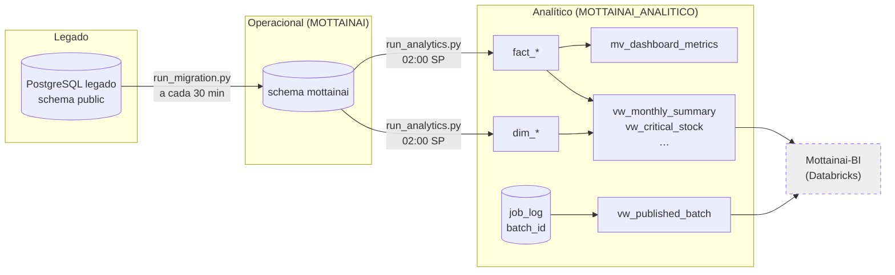
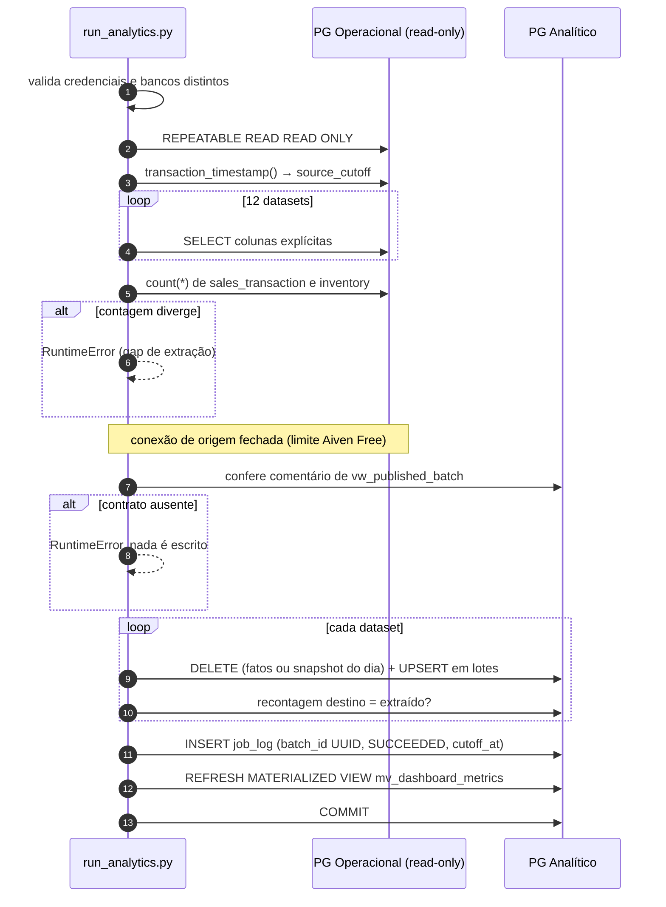
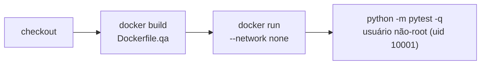

<div align="center">

# Mottanai RPA

**Automação de integração entre os bancos PostgreSQL do Mottainai: gestão preditiva de estoque para pequenos e médios varejos**

*Migra o legado para o banco operacional e publica, todo dia às 02:00 (America/Sao_Paulo), uma fotografia consistente do operacional no banco analítico consumido pelo BI.*

<br/>

[](Dockerfile.qa)
[](requirements.txt)
[](.github/workflows/operational-to-analytics.yml)

[](requirements.txt)
[](Dockerfile.qa)
[](dags/)
[](LICENSE)
[](#12-status-roadmap-e-rastreabilidade)

<br/>

[Visão geral](#1-visão-geral) •
[Arquitetura](#2-arquitetura) •
[Tecnologias](#3-tecnologias) •
[Fluxos](#5-como-os-fluxos-funcionam) •
[Configuração](#6-configuração) •
[Execução](#7-como-executar) •
[Contrato com o BI](#10-contrato-com-o-bi) •
[Riscos](#11-segurança-riscos-e-limitações)

</div>

---

## 1. Visão geral

O **Mottainai** (もったいない, *"que desperdício"*) é um sistema inteligente de gestão preditiva de estoque. Este repositório contém o **RPA de dados**: scripts Python que movem dados entre três bancos PostgreSQL fisicamente separados.

| Fluxo | Origem | Destino | Ponto de entrada | Frequência (agenda ativa na `main`) |
|---|---|---|---|---|
| **Legado → operacional** | PostgreSQL legado, schema `public` | banco `MOTTAINAI`, schema `mottainai` | `run_migration.py` | a cada 30 min (`*/30 * * * *`) via GitHub Actions |
| **Operacional → analítico** | banco `MOTTAINAI`, schema `mottainai` | banco `MOTTAINAI_ANALITICO`, schema `mottainai_analytics` | `run_analytics.py` | diária, 02:00 America/Sao_Paulo, via GitHub Actions |

| | Princípio | Como é implementado no código |
|---|---|---|
| **1** | **Origem somente leitura** | Conexões de origem abertas com `set_session(readonly=True)` / `SET TRANSACTION READ ONLY` |
| **2** | **Bancos fisicamente distintos** | `analytics/load.py` aborta se operacional e analítico apontarem para o mesmo `host/port/dbname` |
| **3** | **Tudo ou nada** | Toda a escrita no analítico ocorre em **uma transação**; falha → `rollback` e a publicação anterior permanece |
| **4** | **Reconciliação de contagens** | Cada tabela de destino é recontada; divergência entre extraído e gravado aborta o lote |
| **5** | **Sem dados pessoais no analítico** | Queries selecionam colunas explícitas, sem CPF, CNPJ, e-mail, telefone, nome de cliente ou hash de senha |
| **6** | **Dry-run por padrão** | `MIGRATION_DRY_RUN` e `ANALYTICS_DRY_RUN` têm padrão `true` nos respectivos fluxos; `run_analytics.py` usa outro caminho, que grava e faz commit |

> [!NOTE]
> O nome do repositório é **`Mottanai-RPA`** (sem o "i"), diferente do nome do produto. Os workflows e a documentação interna usam essa grafia nas URLs.

---

## 2. Arquitetura

### Fluxo de dados ponta a ponta



<sub>`vw_published_batch`, as views de negócio e `mv_dashboard_metrics` **não são criadas por este repositório**; são instaladas pelos scripts SQL do repositório `Mottainai-Banco-Operacional` (ver [seção 10](#10-contrato-com-o-bi)).</sub>

### Duas implementações do fluxo analítico

A `main` contém **duas** implementações operacional → analítico. Apenas uma está ligada à agenda ativa.

| | `analytics/load.py` (**ativa**) | `analytics_daily.py` (alternativa) |
|---|---|---|
| Entrada | `run_analytics.py` | `run_analytics_daily.py` |
| Agendada por | `.github/workflows/operational-to-analytics.yml` e DAG `dags/operational_to_analytics.py` | apenas DAG `dags/mottainai_analytics_daily.py` (Airflow opcional) |
| Escopo | Reconciliação de **todo o histórico** em dimensões e fatos | Staging do **dia anterior** (SP) via funções SQL |
| Publicação | Linha em `job_log` com `batch_id` (UUID gerado no Python) e status `SUCCEEDED` | `fn_publish_daily_batch` → status `PUBLISHED` em `etl_daily_batch` |
| Pré-requisito no banco | View `vw_published_batch` com comentário `publication_contract=analytics_mart_v1` (script `14_publish_mart_view.sql`) | `etl_source_contract` e funções `fn_begin_daily_batch`, `fn_stage_operational_row`, `fn_reconcile_daily_batch`, `fn_mark_daily_batch_transformed`, `fn_publish_daily_batch` |
| Dry-run | não possui | `ANALYTICS_DRY_RUN` (padrão `true`) |

> [!WARNING]
> Segundo `docs/GITHUB_DAILY_LOAD.md`, lotes de `etl_daily_batch` "continuam para auditoria, mas não autorizam a publicação do data mart". Ou seja, o caminho `analytics_daily.py` é tratado como legado/auditoria, mas os documentos `ANALYTICS_DAILY_RUNBOOK.md` e `PR_DESCRIPTION.md` ainda o apresentam como o fluxo principal. Confirme com o time qual é o caminho oficial antes de operar.

---

## 3. Tecnologias

<table>
<tr>
<td align="center" width="140"><br/><b>Python 3.12</b><br/><sub>Imagem QA e<br/>workflows</sub></td>
<td align="center" width="140"><br/><b>PostgreSQL</b><br/><sub>Legado, operacional<br/>e analítico</sub></td>
<td align="center" width="140"><br/><b>GitHub Actions</b><br/><sub>Agenda das cargas<br/>e QA</sub></td>
<td align="center" width="140"><br/><b>Docker</b><br/><sub>Testes isolados<br/>(<code>--network none</code>)</sub></td>
</tr>
<tr>
<td align="center" width="140"><br/><b>pytest</b><br/><sub>Testes unitários</sub></td>
<td align="center" width="140"><br/><b>Apache Airflow</b><br/><sub>DAGs opcionais<br/>(não instalado)</sub></td>
<td align="center" width="140"><br/><b>python-dotenv</b><br/><sub>Configuração<br/>via <code>.env</code></sub></td>
<td align="center" width="140"><br/><b>Git</b><br/><sub>Versionamento</sub></td>
</tr>
</table>

### Versões observadas

| Componente | Versão | Onde |
|---|---|---|
| Python | `3.12` | `Dockerfile.qa` (`python:3.12-slim-bookworm`), `setup-python` nos workflows |
| `psycopg2-binary` | `>=2.9.9,<3` | `requirements.txt` |
| `python-dotenv` | `>=1.0,<2` | `requirements.txt` |
| `tzdata` | `>=2025.2` | `requirements.txt` |
| `pytest` | `>=8,<9` | `requirements.txt` |
| `actions/checkout` / `actions/setup-python` | `v4` / `v5` | workflows |
| Apache Airflow | não fixada (não está em `requirements.txt`) | `dags/*.py` importam com `try/except ImportError` |

> [!NOTE]
> As dependências usam **faixas** de versão, não versões exatas, e não há lockfile. Builds diferentes podem resolver versões diferentes.

---

## 4. Estrutura do repositório

```text
Mottanai-RPA/
├── .github/workflows/
│   ├── legacy-to-operational.yml      # Legado → operacional, cron */30, commit real
│   ├── operational-to-analytics.yml   # Operacional → analítico, 02:00 America/Sao_Paulo
│   └── qa.yml                         # pytest em container sem rede (PR e push na main)
├── analytics/
│   ├── load.py                        # Carga analítica ATIVA (dim_*/fact_* + job_log + MV)
│   └── bootstrap_history.py           # Cópia única do histórico de fact_store_daily
├── dags/
│   ├── operational_to_analytics.py    # DAG 02:00 → analytics.load.run
│   ├── mottainai_analytics_daily.py   # DAG 02:00 → analytics_daily (dry_run=False)
│   └── mottainai_rpa.py               # DAG horária → pipeline genérico
├── docs/                              # Runbooks, mapeamento, QA, guia do GitHub Actions
├── robots/legacy_integration.py       # vazio (0 linhas)
├── tests/                             # test_analytics, test_pipeline, test_relational_migration
├── tools/inspect_legacy_schema.py     # Relatório de schema do legado (information_schema)
├── analytics_daily.py                 # Carga analítica alternativa via funções SQL
├── relational_migration.py            # Migração legado → operacional
├── pipeline.py                        # Pipeline genérico tabela → tabela com quarentena
├── db.py / config.py / settings.py    # Conexões, variáveis de ambiente e parâmetros
├── job_logger.py                      # vazio (0 linhas)
├── run_migration.py / run_analytics.py / run_analytics_daily.py / run_rpa.py
├── Dockerfile.qa / .dockerignore / .env.example / requirements.txt
└── LICENSE (MIT) / README.md
```

---

## 5. Como os fluxos funcionam

### 5.1 Operacional → analítico (`analytics/load.py`, caminho ativo)



<details>
<summary><b>Datasets carregados (12)</b></summary>

<br/>

| Destino | Origem (`mottainai`) | Chave | Estratégia |
|---|---|---|---|
| `dim_company` | `company` + `subscription_plan` | `company_id` | upsert |
| `dim_store` | `retail_store` + `address` (só cidade/UF) | `store_id` | upsert |
| `dim_category` | `product_category` | `category_id` | upsert |
| `dim_product` | `product` | `product_id` | upsert |
| `dim_employee` | `employee` + `employee_role` (sem nome/CPF) | `employee_id` | upsert |
| `dim_customer` | `customer` (só ano de nascimento e consentimento) | `customer_id` | upsert |
| `fact_sales` | `sales_transaction` + `sale_item` | `sale_id, sale_date` | delete total + insert |
| `fact_sale_item` | `sale_item` com `status = 'SOLD'` | `sale_item_id, sale_date` | delete total + insert |
| `fact_sale_payment` | `sale_payment` | `payment_id` | delete total + insert |
| `fact_inventory_movement` | `inventory_movement` + `inventory` + `batch` | `movement_id, movement_date` | delete total + insert |
| `fact_inventory_snapshot` | `inventory` + `batch` (inclui `minimum_quantity`) | `snapshot_date, store_id, product_id, batch_id, inventory_type` | substitui o snapshot do dia |
| `fact_alert_snapshot` | `alert` | `snapshot_date, alert_id` | substitui o snapshot do dia |
| `fact_store_daily` | `retail_store` + `employee` + `app_user` | `snapshot_date, store_id` | substitui o snapshot do dia |

`discount_amount` e `reserved_quantity` são preenchidos com `0` por falta de fonte; `dim_supplier` não é carregada (o destino exige `company_id`, que `supplier` não tem obrigatoriamente).

</details>

### 5.2 Operacional → analítico (`analytics_daily.py`, alternativa)

1. Calcula a **data de negócio** = dia anterior em America/Sao_Paulo.
2. Obtém `pg_advisory_xact_lock` no analítico para impedir execuções concorrentes.
3. Lê `etl_source_contract` (tabelas, modo `SNAPSHOT`/incremental, coluna de watermark) e **valida** contra o `information_schema` do operacional.
4. `fn_begin_daily_batch` abre/recupera o lote; se já estiver `PUBLISHED`, retorna `already_published` (idempotência por data).
5. Extrai cada tabela, remove ~40 chaves sensíveis (`FORBIDDEN_KEYS`) e envia linha a linha a `fn_stage_operational_row`.
6. `fn_reconcile_daily_batch` → `fn_mark_daily_batch_transformed` → `fn_publish_daily_batch`; `COMMIT` (ou `ROLLBACK` em dry-run).

### 5.3 Legado → operacional (`relational_migration.py`)

- Lê **todas** as linhas de `address`, `employeerole`, `subscriptionplan`, `company`, `store`, `employee`, `useraccount` e `administration` antes de escrever.
- Faz upsert em `address`, `employee_role`, `subscription_plan`, `company`, `retail_store`, `employee` e `app_user`, respeitando a ordem de dependências.
- E-mail, telefone, CPF e nome de funcionário: preserva o valor se já estiver mascarado no legado; caso contrário grava um token `PREFIXO_SHA256_<hash>`.
- Senhas só são migradas se já forem **BCrypt**; as demais vão para quarentena (arquivo `migration_quarantine.json`, só com tabela, ID e motivo).
- `administration` não é migrada (sem vínculo no modelo de destino).
- Chama `mottainai.fn_set_legacy_migration_context` antes de gravar funcionários (exigida pelas triggers de auditoria/RLS; ver `docs/OPERATIONAL_DATABASE_RUNBOOK.md`).

### 5.4 Pipeline genérico (`pipeline.py` / `run_rpa.py`)

Copia `SOURCE_TABLE` (legado) para `DESTINATION_TABLE` (operacional) em lotes, normaliza texto (NFKC) e decimais, adiciona `_source_fingerprint` (SHA-256) e `_loaded_at`, e grava rejeições em `rpa_quarantine`. Cria as tabelas de controle `rpa_run`, `rpa_quarantine` e `rpa_watermark`. Não há workflow do GitHub que o execute; só a DAG horária `mottainai_rpa`.

---

## 6. Configuração

Copie `.env.example` para `.env` (ignorado pelo Git) e preencha. **Somente os nomes** das variáveis estão listados abaixo.

| Grupo | Variáveis | Usadas por |
|---|---|---|
| Legado | `LEGACY_DB_HOST`, `LEGACY_DB_PORT`, `LEGACY_DB_NAME`, `LEGACY_DB_USER`, `LEGACY_DB_PASSWORD`, `LEGACY_DB_SSLMODE` | migração, pipeline genérico, `tools/` |
| Operacional | `OPERATIONAL_DB_HOST`, `OPERATIONAL_DB_PORT`, `OPERATIONAL_DB_NAME`, `OPERATIONAL_DB_USER`, `OPERATIONAL_DB_PASSWORD`, `OPERATIONAL_DB_SSLMODE` | todos os fluxos |
| Analítico | `ANALYTICS_DB_HOST`, `ANALYTICS_DB_PORT`, `ANALYTICS_DB_NAME`, `ANALYTICS_DB_USER`, `ANALYTICS_DB_PASSWORD`, `ANALYTICS_DB_SSLMODE` | `analytics/`, `analytics_daily.py` |
| Carga analítica | `ANALYTICS_SOURCE_SCHEMA` (padrão `mottainai`), `ANALYTICS_TARGET_SCHEMA` (padrão `mottainai_analytics`), `ANALYTICS_BATCH_SIZE` (padrão `1000`) | `analytics/load.py` |
| Carga diária alternativa | `OPERATIONAL_SCHEMA`, `ANALYTICS_SCHEMA`, `ANALYTICS_DRY_RUN` (padrão `true`) | `analytics_daily.py` |
| Migração | `SOURCE_SCHEMA`, `DESTINATION_SCHEMA`, `MIGRATION_DRY_RUN` (padrão `true`), `MIGRATION_QUARANTINE_FILE` | `relational_migration.py` |
| Pipeline genérico | `SOURCE_TABLE`, `SOURCE_INCREMENTAL_COLUMN`, `DESTINATION_TABLE`, `BATCH_SIZE`, `MAX_RETRIES`, `DRY_RUN` | `pipeline.py` |

> [!WARNING]
> `.env.example` **não contém** as variáveis `ANALYTICS_DB_*` necessárias às conexões analíticas nem `ANALYTICS_DRY_RUN`, usada pelo fluxo alternativo. Elas aparecem em `config.py`, no workflow e em `docs/ANALYTICS_DATABASE_ALIGNMENT.md`.

Conexões usam `connect_timeout=15`, `application_name="mottainai-rpa"` e, em `db.connect`, até 3 tentativas com backoff exponencial. `sslmode` padrão é `require`.

---

## 7. Como executar

### Pré-requisitos

- [ ] Python 3.12 e dependências de `requirements.txt`
- [ ] Bancos instalados pelos scripts do repositório de banco (schema `mottainai` no operacional; `database/analytics/install.sql` e `14_publish_mart_view.sql` no analítico, conforme `docs/`)
- [ ] Contas separadas: **leitura** no operacional, **escrita** no analítico
- [ ] `.env` preenchido (nunca versionado)

### Comandos documentados no repositório

```bash
pip install --requirement requirements.txt

# Legado → operacional (dry-run por padrão)
python run_migration.py

# Operacional → analítico (caminho ativo; NÃO tem dry-run, grava e faz commit)
python run_analytics.py

# Operacional → analítico (caminho alternativo; dry-run por padrão)
python run_analytics_daily.py

# Histórico de fact_store_daily a partir do antigo schema MOTTAINAI.analytics (uma vez)
python -m analytics.bootstrap_history

# Testes locais
python -m pytest -q
```

Os runbooks usam PowerShell (Windows) para alternar o modo:

```powershell
$env:ANALYTICS_DRY_RUN="true"
.\.venv\Scripts\python.exe -u run_analytics_daily.py

$env:MIGRATION_DRY_RUN="true"
.\.venv\Scripts\python.exe -u run_migration.py
```

> [!CAUTION]
> `python run_analytics.py` escreve diretamente no analítico e publica um novo `batch_id`. Não existe modo de simulação nesse caminho.

---

## 8. Agendamento e operação

| Agendador | Job | Cron | Fuso | Concorrência | Timeout | Retries |
|---|---|---|---|---|---|---|
| GitHub Actions | `legacy-to-operational.yml` | `*/30 * * * *` | UTC (sem `timezone`) | `concurrency` sem cancelamento | 20 min | — |
| GitHub Actions | `operational-to-analytics.yml` | `0 2 * * *` | `timezone: America/Sao_Paulo` | `concurrency` sem cancelamento | 30 min | — |
| Airflow (opcional) | `mottainai_operational_to_analytics` | `0 2 * * *` | `start_date` com SP | `max_active_runs=1` | — | 3 × 10 min |
| Airflow (opcional) | `mottainai_operational_to_analytics_daily` | `0 2 * * *` | não definido no DAG | `max_active_runs=1` | 30 min | 3 × 10 min |
| Airflow (opcional) | `mottainai_rpa` | `0 * * * *` | não definido | — | — | 3 × 5 min |

```mermaid
gantt
    title Janela diária (America/Sao_Paulo)
    dateFormat HH:mm
    axisFormat %H:%M
    section RPA
    Legado para operacional (a cada 30 min)  :active, 00:00, 4h
    Operacional para analítico               :crit, 02:00, 30m
    section BI
    Agenda de contingência do Databricks     :milestone, 02:30, 0m
```



<sub>Durações ilustrativas. O workflow tem `timeout-minutes: 30`; a duração real não foi medida neste repositório.</sub>

- **Execução manual:** os dois workflows aceitam `workflow_dispatch`. No legado, o input `dry_run` vale `true` por padrão em disparo manual; **execuções agendadas usam `MIGRATION_DRY_RUN=false`** (commit real).
- **Atraso:** GitHub Actions pode iniciar após 02:00 em fila; `job_log.cutoff_at` registra o início real da leitura.
- **Logs:** apenas `logging` em stdout (logs do Actions). Persistência: `job_log` (analítico, só em sucesso), `rpa_run`/`rpa_quarantine` (pipeline genérico) e `migration_quarantine.json` (arquivo local, efêmero no runner).
- **Falhas:** no analítico, `rollback` completo e a publicação anterior continua válida. Uma falha **não** gera linha em `job_log` e não há alerta configurado no repositório.

<details>
<summary><b>Consultas de verificação pós-carga (de <code>docs/</code>)</b></summary>

<br/>

```sql
SELECT job_id, batch_id, cutoff_at, finished_at, rows_read, rows_written,
       metadata ->> 'publication_contract' AS publication_contract
FROM mottainai_analytics.job_log
WHERE job_name = 'operational_to_analytics_daily'
ORDER BY job_id DESC LIMIT 3;

SELECT count(*) FROM mottainai_analytics.fact_sales;
SELECT count(*) FROM mottainai_analytics.fact_inventory_snapshot;
SELECT * FROM mottainai_analytics.vw_published_batch;
```

</details>

---

## 9. Testes e CI

| Arquivo | Cobre |
|---|---|
| `tests/test_analytics.py` | Datasets sem colunas sensíveis e chaves contidas nas colunas; rejeição de identificador com injeção SQL; falha sem credenciais do operacional; conversão para o fuso de SP |
| `tests/test_pipeline.py` | Normalização de texto e decimal, fingerprint estável, `quote_identifier`, linhagem em `transform_record` |
| `tests/test_relational_migration.py` | Normalização de CNPJ, tokenização de CPF, preservação de CPF mascarado, UF a partir do nome do estado |

O workflow [`qa.yml`](.github/workflows/qa.yml) roda em PR, push na `main` e manualmente:



```bash
docker build -f Dockerfile.qa -t mottainai-rpa:qa .
docker run --rm --network none mottainai-rpa:qa
```

> [!IMPORTANT]
> Os testes são **unitários e sem banco**. Não há teste de integração contra PostgreSQL descartável, nem testes para `analytics_daily.py`, para a ordem transacional de `load.py` ou para idempotência real. `docs/QA.md` registra isso como trabalho futuro.

---

## 10. Contrato com o BI

O repositório `Mottainai-BI` espera: RPA diário às 02:00 → schema `mottainai_analytics` → lote com `batch_id` exposto em `vw_published_batch` (colunas `batch_id`, `source_cutoff_at`, `published_at`) → views `vw_sales_daily_kpis`, `vw_monthly_summary`, `vw_critical_stock`.

| Item do contrato | O que o RPA (`main`) faz | Situação |
|---|---|---|
| Execução diária às 02:00 SP | `operational-to-analytics.yml` com `cron: "0 2 * * *"` e `timezone: America/Sao_Paulo` | ✅ confirmado (sujeito a atraso de fila) |
| Operacional → `mottainai_analytics` | `ANALYTICS_TARGET_SCHEMA=mottainai_analytics` | ✅ confirmado |
| `batch_id` por lote | UUID gerado em Python (`uuid4`) e gravado em `job_log.batch_id` na mesma transação dos fatos | ✅ confirmado |
| `vw_published_batch` | O RPA **não cria** a view; apenas exige o comentário `publication_contract=analytics_mart_v1`. Segundo `docs/`, a view é definida em `14_publish_mart_view.sql` (repo do banco) sobre `job_log` | ⚠️ depende de outro repositório |
| Status do lote | O caminho ativo grava `SUCCEEDED` em `job_log`. A view oficial filtra esse status, o nome do job, o identificador do lote, o horário de corte e o contrato `analytics_mart_v1` | ✅ alinhado no SQL versionado; validar a instalação no ambiente |
| Colunas `source_cutoff_at` / `published_at` | A view oficial mapeia `cutoff_at` e `finished_at` de `job_log` para os nomes esperados pelo BI | ✅ confirmado no SQL versionado; validar no ambiente |
| `vw_monthly_summary`, `vw_critical_stock` | Citadas na validação de `docs/ANALYTICS_DAILY_LOAD.md`; o RPA alimenta `fact_sales` e `fact_inventory_snapshot` (com `minimum_quantity`) | ✅ citadas; definição externa |
| `vw_sales_daily_kpis` | Definida em `database/analytics/07_views.sql` na branch `develop` do repositório do banco | ✅ definição encontrada; validar acesso no ambiente analítico |
| Disparo do job Databricks (`run-now`) | Não existe no RPA; os docs mandam rodar o job Bronze/Silver/Gold manualmente | ⏳ pendente (coerente com o roadmap do BI) |

> [!WARNING]
> **Contrato da publicação:** o script `database/analytics/14_publish_mart_view.sql` do banco define a view sobre `job_log` com status `SUCCEEDED` e os aliases esperados pelo BI. Confira se essa migração e as views analíticas foram instaladas no ambiente antes de habilitar a integração; não houve validação em banco real nesta análise.

---

## 11. Segurança, riscos e limitações

### Controles observados

- Credenciais apenas por variável de ambiente / GitHub Secrets; `.env` no `.gitignore` e `.dockerignore`. **Nenhuma credencial hardcoded** foi encontrada nos arquivos versionados.
- Identificadores SQL validados por regex (`^[A-Za-z_][A-Za-z0-9_]*$`) e valores via parâmetros do psycopg2.
- Workflows com `permissions: contents: read`; QA sem rede e com usuário não-root.
- Quarentena da migração não grava payload nem senha.

### Riscos

| # | Risco | Impacto | Evidência |
|:---:|---|---|---|
| 1 | **Contrato analítico depende de migração e acesso às views** (`vw_published_batch` e `vw_sales_daily_kpis`) | BI pode ler lote errado ou falhar no preflight | [seção 10](#10-contrato-com-o-bi) |
| 2 | **Duas implementações analíticas e três DAGs** (duas às 02:00 apontando para caminhos diferentes) | Se Airflow for ativado junto com o Actions, cargas concorrentes ou divergentes | `dags/`, `analytics/load.py`, `analytics_daily.py` |
| 3 | **Reconciliação total em memória** a cada execução (delete + reinsert de todos os fatos) | Tempo e memória crescem com o histórico; risco de estourar os 30 min | comentário em `analytics/load.py`, `docs/ANALYTICS_DAILY_LOAD.md` |
| 4 | **Migração do legado agendada a cada 30 min com commit quando habilitada**, lendo tabelas inteiras e usando `0` como FK de fallback (`maps.get(..., 0)`) | Carga e escrita contínuas no operacional; FK inválida gera erro e rollback em vez de quarentena | `legacy-to-operational.yml`, `relational_migration.py` |
| 5 | **Tokens SHA-256 sem sal** para CPF/e-mail/telefone | CPF tem espaço pequeno; o hash é reversível por força bruta (pseudonimização fraca, relevante para LGPD) | `protected_token` em `relational_migration.py` |
| 6 | **Quarentena do pipeline genérico grava a linha inteira** (`json.dumps(dict(row))`) em `rpa_quarantine` | Possível persistência de dados pessoais do legado | `pipeline.py` |

### Limitações conhecidas

- `discount_amount` e `reserved_quantity` são `0`; `mv_dashboard_metrics.monthly_economy` fica `NULL`; `dim_supplier` não é carregada.
- Timestamps sem fuso são interpretados como horário de São Paulo; precisa ser confirmado com o aplicativo.
- Falhas não geram registro persistente nem alerta (só log do Actions).
- `analytics/load.py` não tem dry-run nem lock explícito (depende do `concurrency` do Actions).
- `.env.example` incompleto (sem `ANALYTICS_DB_*`); `settings.py` usa `integration` como `DESTINATION_SCHEMA` padrão, diferente de `mottainai` no `.env.example`.
- `job_logger.py` e `robots/legacy_integration.py` estão vazios.
- O suporte do GitHub Actions à chave `timezone` em `schedule` não foi verificado nesta análise; se não for aceita, o horário efetivo muda.

---

## 12. Status, roadmap e rastreabilidade

| Item | Status |
|---|:---:|
| Migração legado → operacional |  |
| Carga operacional → analítico com `batch_id` |  |
| QA isolado em container |  |
| Execução real registrada |  |
| Testes de integração com PostgreSQL |  |
| CDC/watermarks no fluxo ativo |  |
| Gatilho do job Databricks após publicação |  |

<sub>"Execução real registrada": `docs/ANALYTICS_DAILY_RUNBOOK.md` relata um lote publicado em 2026-10-19 para 2026-10-18 com `rows_staged = 0` — do caminho **alternativo** (`run_analytics_daily.py`). Não há registro de execução do caminho ativo no repositório.</sub>

### Próximos passos sugeridos

- [ ] Definir oficialmente um único caminho analítico e remover/arquivar o outro e suas DAGs
- [ ] Validar a migração de `vw_published_batch` e o acesso a `vw_sales_daily_kpis` no ambiente analítico usado pelo `Mottainai-BI`
- [ ] Completar `.env.example` com `ANALYTICS_DB_*` e `ANALYTICS_DRY_RUN`
- [ ] Adicionar dry-run e registro de falha (`job_log` com status de erro) em `analytics/load.py`
- [ ] Teste de integração com PostgreSQL descartável cobrindo idempotência e rollback
- [ ] Incremental por watermark/CDC antes de o volume crescer
- [ ] HMAC com chave secreta (em vez de SHA-256 puro) para tokens de dados pessoais

---

<details>
<summary><b>Nota de rastreabilidade</b></summary>

<br/>

- **Repositório:** `Mottainai-One/Mottanai-RPA`, branch `main`
- **Commit analisado:** `227f112` (merge da PR #9 `fix/analytics-daily-publication`, 2026-10-26). Histórico completo local com 8 commits; a única branch presente no clone é `main` (outras branches remotas não foram listadas)
- **Data da análise:** 2026-10-27
- **Método:** leitura estática do código e da documentação; nenhum script, container ou consulta a banco foi executado
- **Arquivos consultados:** `README.md`, `requirements.txt`, `.env.example` (somente nomes), `.gitignore`, `.dockerignore`, `Dockerfile.qa`, `LICENSE`, `.github/workflows/legacy-to-operational.yml`, `.github/workflows/operational-to-analytics.yml`, `.github/workflows/qa.yml`, `config.py`, `settings.py`, `db.py`, `pipeline.py`, `relational_migration.py`, `analytics_daily.py`, `analytics/__init__.py`, `analytics/load.py`, `analytics/bootstrap_history.py`, `run_rpa.py`, `run_migration.py`, `run_analytics.py`, `run_analytics_daily.py`, `dags/mottainai_rpa.py`, `dags/operational_to_analytics.py`, `dags/mottainai_analytics_daily.py`, `tests/test_analytics.py`, `tests/test_pipeline.py`, `tests/test_relational_migration.py`, `tools/inspect_legacy_schema.py`, `docs/ANALYTICS_DAILY_LOAD.md`, `docs/ANALYTICS_DAILY_RUNBOOK.md`, `docs/ANALYTICS_DATABASE_ALIGNMENT.md`, `docs/GITHUB_DAILY_LOAD.md`, `docs/MAPPING.md`, `docs/OPERATIONAL_DATABASE_RUNBOOK.md`, `docs/PR_DESCRIPTION.md`, `docs/QA.md`
- **Não verificado:** DDL de `vw_published_batch`, das views de negócio e das funções `fn_*` (vivem no repositório `Mottainai-Banco-Operacional`); histórico de execuções do GitHub Actions; segredos configurados

</details>

<div align="center">

**Mottainai** · *menos desperdício, mais inteligência no estoque*

<sub>Parte do ecossistema <a href="https://github.com/Mottainai-One">Mottainai-One</a></sub>

</div>
